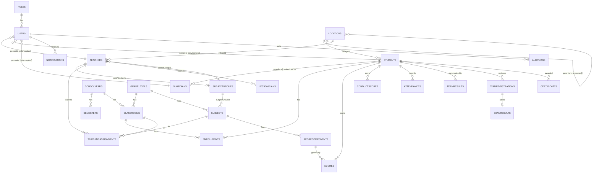

# MongoDB Collection Design

> เอกสารนี้อธิบายการแปลง schema เชิงสัมพันธ์ (PostgreSQL, UUID + FK) มาเป็น document model
> บน MongoDB พร้อมเหตุผลของการตัดสินใจ **embed vs reference** และ index ที่จำเป็น

**Decisions ที่ยืนยันแล้ว:** NestJS · single-tenant (หนึ่ง deployment ต่อหนึ่งโรงเรียน) ·
backend API อย่างเดียว · MinIO (S3-compatible) สำหรับไฟล์

---

## 1. หลักการตัดสินใจ (Decision rubric)

การเลือก embed หรือ reference ในเอกสารนี้ใช้เกณฑ์ 4 ข้อ เรียงตามลำดับความสำคัญ:

| # | เกณฑ์ | ผลลัพธ์ |
|---|---|---|
| 1 | **Unbounded growth?** array ที่โตได้ไม่จำกัดตามเวลา | → **reference** เสมอ (เอกสาร Mongo จำกัด 16 MB) |
| 2 | **ถูกอ้างอิงจากหลาย parent?** | → **reference** (เลี่ยง update หลายที่) |
| 3 | **อ่านคู่กับ parent เกือบทุกครั้ง + เปลี่ยนน้อย?** | → **embed** |
| 4 | **ต้อง query ข้ามโดยไม่ผ่าน parent?** | → **reference** (หรือ embed + duplicate key) |

**หลักเพิ่มเติมที่ใช้ทั้งระบบ**

- **`_id` เป็น `ObjectId`** ทุก collection — ประหยัดกว่า UUID string 2 เท่า (12 B vs 36 B),
  index เล็กกว่า และมี timestamp ในตัว ส่วน "รหัส" ที่มนุษย์ใช้ (`studentCode`, `teacherCode`)
  เก็บเป็น field แยกพร้อม unique index
- **Denormalization แบบมีขอบเขต** — คัดลอกเฉพาะ field ที่ *ไม่เปลี่ยน หรือเปลี่ยนน้อยมาก*
  (เช่น `studentCode`, ชื่อ) ไปเก็บคู่กับ reference เพื่อลด `$lookup` ในหน้า list
  ทุกจุดที่ทำแบบนี้จะมี comment `// denormalized` และมีจุด sync ที่ระบุชัดในเอกสารนี้
- **Soft delete** ผ่าน `deletedAt` (nullable) กับ master data ที่ถูกอ้างอิง — กันข้อมูลย้อนหลังพัง
- **Enum** → TypeScript union type + Mongoose `enum` validator ประกาศที่เดียวใน
  `src/common/constants/enums.ts`
- **`jsonb`** เดิม → `Mixed` เฉพาะที่โครงสร้างอิสระจริง (`settings.value`,
  `reportTemplates.layout`, `auditLogs.oldValue/newValue`) นอกนั้นใช้ sub-schema ที่กำหนดชัด
  (`roles.permissions` เป็น sub-schema เพราะต้อง validate และ query ได้)

---

## 2. ตารางสรุปการตัดสินใจ

| Collection | ความสัมพันธ์เดิม | ตัดสินใจ | เหตุผล |
|---|---|---|---|
| `users` | FK → teacher/student/guardian | **reference แบบ polymorphic** (`personType` + `personId`) | user หนึ่งผูกกับบุคคลได้แบบเดียว; แยก auth ออกจาก profile ทำให้ rotate password/token ไม่แตะ document บุคคล |
| `roles` | 1-M กับ users, `permissions` jsonb | collection แยก + **embed permission matrix** | role มีไม่กี่สิบ record, permissions อ่านคู่กันเสมอตอน authorize, และ cache ใน Redis ได้ทั้งก้อน |
| `teachers` | ตารางหลัก | collection แยก | ถูกอ้างจาก classrooms / teachingAssignments / lessonPlans |
| `students` | ตารางหลัก | collection แยก + **embed `guardians[]` แบบย่อ** | หน้า profile นักเรียนต้องโชว์ผู้ปกครองเกือบทุกครั้ง และมี 1–4 คน (bounded) |
| `guardians` | ตารางหลัก | collection แยก (full record) | ผู้ปกครองหนึ่งคนมีลูกหลายคน → ถ้า embed อย่างเดียวจะซ้ำและ update ยาก |
| `studentGuardians` | join table + metadata | **embed ใน `students.guardians[]`** | ความสัมพันธ์อ่านจากฝั่งนักเรียนเป็นหลัก, bounded, metadata (`relationship`, `isPrimary`, `isEmergencyContact`) ผูกกับคู่ความสัมพันธ์ |
| `locations` | self-reference `parentId` | collection แยก + **`ancestors[]` (materialized path)** | Mongo ไม่มี recursive CTE — เก็บ ancestors ทำให้ "ทุกหมู่บ้านในแขวง X" เป็น query เดียว |
| `schoolYears`, `semesters`, `gradeLevels` | master data | collection แยก | ถูกอ้างจากแทบทุกที่, จำนวนน้อย → cache ได้ |
| `classrooms` | FK ครูประจำชั้น | collection แยก | ถูกอ้างจาก enrollments/teachingAssignments |
| `subjectGroups` | สายวิชา (ໜ່ວຍ/ສາຍ) | collection แยก | เป็น "แกน" ที่ `subjects` และ `teachers` อ้างถึง และเป็นเส้นทางส่งงานให้หัวหน้าสาย — ดู §3.9 |
| `subjects` | FK grade level + subject group | collection แยก | ถูกอ้างจาก scores/teachingAssignments |
| `teachingAssignments` | join + schedule | collection แยก + **embed `schedule[]`** | คาบสอนต่อการมอบหมายมี bounded (~1–6 คาบ/สัปดาห์) และต้องอ่านคู่กันเพื่อตรวจ conflict |
| `enrollments` | join table | collection แยก | โตตามจำนวน นักเรียน × ปี — unbounded ในระยะยาว |
| `scoreComponents` | 1-M ต่อวิชา/เทอม | collection แยก + **`weight` sum ≤ 100 validate ที่ service** | ครูแก้ weight ได้ระหว่างเทอม, ถูกอ้างจากทุก score record |
| `scores` | 1-M ขนาดใหญ่ | collection แยก | นักเรียน × วิชา × component × เทอม = โตเร็วมาก |
| `conductScores` | 1-M รายเดือน/ภาค/ปี | collection แยก | โตตามเวลา |
| `attendances` | 1-M รายวัน | collection แยก | โตเร็วที่สุดในระบบ (นักเรียน × วัน × คาบ) |
| `termResults` | 1-M ผลสรุป | collection แยก + **embed `subjects[]` breakdown** | ผลรายวิชาของเทอมนั้น bounded (~8–15 วิชา) และอ่านคู่กันตอนออก report card |
| `lessonPlans` | 1-M + activities + reviews | collection แยก + **embed `activities[]` และ `reviews[]`** | lifecycle ผูกกับ plan เดียว, bounded, ไม่ถูกอ้างจากที่อื่น |
| `announcements` | + `announcementTargets` | collection แยก + **embed `targets[]`** | target มีไม่กี่รายการต่อประกาศ และใช้ตอน resolve ผู้รับเท่านั้น |
| `notifications` | 1-M ต่อ user | collection แยก + **TTL index** | unbounded; ลบอัตโนมัติหลัง 90 วัน |
| `auditLogs` | append-only | collection แยก + **TTL index** | unbounded, write-heavy, ไม่ควรอยู่ใน document อื่น |
| `settings` | key-value | collection แยก, `value` เป็น `Mixed` | คนละ shape ต่อ key |

---

## 3. รายละเอียดการตัดสินใจที่ไม่ตรงไปตรงมา

### 3.1 `studentGuardians` → embed ใน `students`, full record ใน `guardians`

Schema เดิมเป็น join table สามทาง (student ↔ guardian + metadata) ในเอกสาร model
เราแยกเป็นสองส่วน:

```
guardians          (full record: ชื่อ, อาชีพ, เบอร์, ที่อยู่, บัตรประชาชน)
students.guardians[]  { guardianId, fullName*, phone*, relationship,
                        isPrimary, isEmergencyContact }   // * = denormalized
```

**ทำไมไม่ embed guardian ทั้งก้อน** — ผู้ปกครองหนึ่งคนมักมีลูกหลายคนในโรงเรียนเดียวกัน
ถ้า embed ทั้ง record การเปลี่ยนเบอร์โทรต้องไล่ update ทุกนักเรียน

**ทำไมไม่ reference อย่างเดียว** — หน้ารายชื่อนักเรียนและใบรายงานผลต้องโชว์
"ผู้ปกครองหลัก + เบอร์ติดต่อ" เสมอ การ `$lookup` ทุกแถวในหน้า list 50 รายการเป็นต้นทุนที่เลี่ยงได้

**จุด sync** — `GuardiansService.update()` เขียน `guardians` แล้ว `$set` field ที่ denormalize
ใน `students.guardians.$[el]` ภายใน transaction เดียวกัน (ดู
`src/modules/guardians/guardians.service.ts`) นี่คือ **จุดเดียว** ที่ sync field เหล่านี้

**Query จากฝั่งผู้ปกครอง** ("ผู้ปกครองคนนี้มีลูกกี่คน") ใช้
`students.find({ 'guardians.guardianId': id })` — มี index รองรับ

### 3.2 `locations` → ancestors array (materialized path)

Self-reference tree (province → district → village) ใน Mongo ทำได้หลายแบบ เราเลือก
**ancestors array** เพราะ query pattern จริงของระบบคือ "กรองนักเรียนตามแขวง/เมือง":

```jsonc
{
  "_id": "...village",
  "nameLo": "ບ້ານໂພນສະຫວັນ",
  "type": "village",
  "parentId": "...district",
  "ancestors": ["...province", "...district"],  // เรียงจากรากลงมา
  "path": ",province,district,",                // สำหรับ prefix regex
  "depth": 2
}
```

- "ทุกหมู่บ้านในแขวง X" → `{ ancestors: provinceId }` — index เดียว, ไม่ต้อง recursive
- `$graphLookup` ทำได้แต่ช้ากว่ามากและ index ช่วยไม่ได้เต็มที่
- Tree มี 3 ระดับคงที่และแทบไม่เปลี่ยน → cache ทั้ง tree ใน Redis (TTL 1 ชม.)
- ต้นทุน: ย้าย node ต้อง update ancestors ของลูกหลานทั้งหมด — ยอมรับได้เพราะแทบไม่เกิด

**`code` คือ identity ของ node** — ไม่ใช่ชื่อ ระบบยึดรหัสทางการ (แขวง `01`, เมือง
`0101`, บ้าน `0101001`) ตามรายการที่ทางการออกให้ เก็บไว้ที่
`src/database/locations/lao-address.data.ts` (18 แขวง, 149 เมือง และบ้านของ
นะคອນຫຼວງວຽງຈັນ 488 บ้าน — รายการทางการมีบ้านเฉพาะนครหลวง) นำเข้าด้วย

```bash
npm run import:locations -- --dry-run   # ดูก่อนว่าจะเปลี่ยนอะไร
npm run import:locations
```

รันซ้ำได้: upsert ตาม `code` และ **จับ row เดิมที่ชื่อตรงกันมาใช้ `_id` เดิม** เพื่อไม่ให้
`villageId` ของนักเรียน/ครู/ผู้ปกครองที่ชี้อยู่กลายเป็นขยะ แถวที่สะกดซ้ำจะถูกยุบเข้าตัวหลัก
พร้อมย้าย reference ส่วนชื่อที่รายการทางการไม่มีจะถูกเก็บไว้ (ไม่มี `code`) แล้วรายงานใน
`data/location-import-report.json` ให้ธุรการตัดสิน

ผลตามมา: **importer ทั้งสองตัวไม่สร้าง location อีกแล้ว** (`resolveOfficialVillage`) —
ที่อยู่ที่จับคู่ไม่ได้จะถูกรายงานและ **ไม่เขียนทับ `villageId` เดิม** เพราะ null ที่แปลว่า
"อ่านไม่ออก" ไม่ใช่ null ที่แปลว่า "ไม่มีที่อยู่"

### 3.3 `scores` → หนึ่ง document ต่อ (นักเรียน, component)

ทางเลือกที่พิจารณา: embed คะแนนทุก component ไว้ใน enrollment เดียว

**ไม่เลือก** เพราะ:
- ครูคนละคนสอนคนละวิชาแต่จะเขียน document เดียวกัน → write contention
- การ lock คะแนน (`isLocked`) เป็นรายวิชา/รายเทอม ไม่ใช่รายนักเรียน
- audit ของการแก้คะแนนหลัง lock ต้องอ้างถึง score record เจาะจง

โครงที่ใช้ — flat document พร้อม key ครบสำหรับ query โดยไม่ join:

```jsonc
{
  "studentId": "...", "subjectId": "...", "componentId": "...",
  "schoolYearId": "...", "semesterId": "...", "classroomId": "...",
  "score": 17.5, "maxScore": 20,
  "isLocked": true, "lockedAt": "...", "lockedBy": "...",
  "recordedBy": "...", "revisionCount": 0
}
```

`schoolYearId`/`semesterId`/`classroomId` เป็น denormalized จาก enrollment — ทำให้
aggregation คำนวณ term result ไม่ต้อง `$lookup` เลย และค่าเหล่านี้ **ไม่เปลี่ยน**
หลังบันทึก (ถ้านักเรียนย้ายห้อง คะแนนเทอมเดิมต้องอยู่กับห้องเดิม) → ปลอดภัยที่จะ denormalize

**Unique index** `{ studentId, componentId }` กันบันทึกซ้ำ และทำให้ upsert ปลอดภัย

### 3.4 `termResults` → embed `subjects[]`

ผลรายวิชาต่อเทอมมีขอบเขตชัด (~8–15 วิชา) และถูกอ่านพร้อมกันเสมอตอนออก report card:

```jsonc
{
  "studentId": "...", "semesterId": "...", "classroomId": "...",
  "subjects": [
    { "subjectId": "...", "subjectNameLo": "ຄະນິດສາດ",  // denormalized
      "totalScore": 82.5, "maxScore": 100, "percentage": 82.5,
      "grade": "B", "gradePoint": 3.0, "isPassed": true,
      "components": [{ "componentId": "...", "name": "ສອບເສັງກາງພາກ",
                       "score": 17.5, "maxScore": 20, "weight": 20,
                       "weightedScore": 17.5 }] }
  ],
  "average": 82.5, "grade": "B", "rank": 3, "totalStudents": 42,
  "conductGrade": "excellent",
  "computedAt": "...", "computationVersion": 2
}
```

`computationVersion` ทำให้ re-compute แล้วรู้ว่าใช้สูตรรุ่นไหน — สำคัญเพราะเกณฑ์เกรด
เปลี่ยนได้จาก `settings`

### 3.5 `teachingAssignments` → embed `schedule[]` + การตรวจ conflict

```jsonc
{
  "teacherId": "...", "subjectId": "...", "classroomId": "...",
  "semesterId": "...",
  "schedule": [
    { "dayOfWeek": 1, "startTime": "08:00", "endTime": "08:50", "room": "A101" }
  ]
}
```

เวลาเก็บเป็น `"HH:mm"` string — เทียบกันแบบ lexicographic ได้ตรงกับลำดับเวลา
และไม่มีปัญหา timezone (คาบเรียนเป็นเวลาท้องถิ่นเสมอ)

Conflict มี 3 แบบ ตรวจทั้งหมดใน `TeachingAssignmentsService.assertNoConflict()`:
1. **ครูซ้อน** — ครูคนเดียวกัน เทอมเดียวกัน คาบทับกัน
2. **ห้องเรียนซ้อน** — classroom เดียวกัน คาบทับกัน (นักเรียนอยู่ได้ที่เดียว)
3. **ห้องกายภาพซ้อน** — `room` เดียวกัน คาบทับกัน (ข้ามได้ถ้า `room` ว่าง)

เงื่อนไขทับ: `existing.startTime < new.endTime && new.startTime < existing.endTime`

### 3.5.1 `lessonSubstitutions` → claim ต่อ (คาบ, วัน) ไม่ใช่ teachingAssignment ใบที่สอง

วันที่ครูประจำวิชาไม่มา แล้วครูอีกคนเข้าสอนแทน คนที่ยืนอยู่หน้าห้องจริง ๆ
บันทึกการเข้าเรียนและพฤติกรรมไม่ได้ เพราะ gate ของทั้งสอง log ถามว่า
"คุณเป็นครูของคาบนี้ตามตารางหรือไม่" — ออฟฟิศจึงต้องคีย์ให้จากใบจดในกระดาษ

```jsonc
{
  "teachingAssignmentId": "...", "date": "2026-09-30T00:00:00Z",
  "substituteTeacherId": "...",   // คนที่สอนแทน = คนที่ต้องบันทึก และคนที่รายงานจะทวง
  "ownerTeacherId": "...",        // snapshot ของครูตามตาราง ณ เวลาที่รับ
  "classroomId": "...", "subjectId": "...", "semesterId": "...",
  "reason": "ລາປ່ວຍ", "claimedBy": "..."
}
```

**ทำไมไม่เพิ่ม `teachingAssignments` อีกใบให้ครูสอนแทน** — จะชนกับ unique index
`(teacherId, subjectId, classroomId, semesterId)`, ทำให้ `assertNoConflict()`
ฟ้องครูซ้อน/ห้องซ้อน (§3.5) และจะเพิ่มตัวหารของทุกรายงาน coverage / timeliness /
ภาระงาน ไปตลอดเทอม — จ่ายค่าสอนแทนหนึ่งวันด้วยรายงานผิดหนึ่งเทอม

**ทำไมเก็บ `ownerTeacherId` ซ้ำ** — ออฟฟิศย้ายครูผู้สอนกลางเทอมได้
ถ้าอ่านย้อนจาก assignment ประวัติการสอนแทนจะเปลี่ยนคำตอบไปด้วย

**ทำไม claim เป็นรายวันไม่ใช่รายคาบ** — งานเอกสารถูกตัดสินเป็น
"หนึ่งครั้งต่อห้องต่อวัน" (ดู `record-timeliness`) ถ้า claim ละเอียดกว่านั้น
คาบคู่วันเดียวกันจะต้องรับสองใบโดยไม่มีอะไรอ่านความละเอียดนั้น

**ถอน = soft delete** — `deletedAt` เป็นสิ่งที่ทั้ง unique index และทุก query
filter อยู่แล้ว ถอนใบหนึ่งจึงทั้งเปิดวันนั้นให้คนอื่นรับได้ และคืนความรับผิดชอบ
ให้ครูตามตารางในทันที โดยไม่ต้องมี field `revoked` แยกที่ทุก query ต้องจำ

**การโยกความรับผิดชอบเป็น derive-on-read** — ไม่มีอะไรถูกเขียนทับย้อนหลัง
รายงานทั้งสอง (`buildCoverage`, `buildTimeliness`) วนต่อ (คาบ × วัน) อยู่แล้ว
และไม่เคยเก็บว่าวันนั้นเป็นของใคร — มันคำนวณจาก `SubstitutionIndex` ที่ส่งเข้าไป
คาบที่มีคนรับสอนแทนจะออกมาเป็น **สองแถว** คนละชื่อ ไม่ใช่แถวเดียวที่เปลี่ยนป้าย
เพราะ reminder ที่สร้างจากรายงานส่งหาคนที่ชื่ออยู่บนแถว

**สิทธิ์ที่ claim ให้ แคบโดยเจตนา** — เฉพาะ `attendances` และ `behaviorLogs`
ของวันนั้น ไม่รวมการให้คะแนน: `ScoresService.assertCanGrade` และ
`MonthlyMarksService.canEdit` เช็คระดับ assignment ไม่ใช่ระดับวัน และต้องเป็นอย่างนั้นต่อไป
สอนแทนหนึ่งวันไม่ใช่การรับช่วงคะแนนทั้งเทอม

### 3.5.2 `classrooms.homeroomHistory` → interval list, และการสืบทอดเมื่อครูออกกลางเทอม

ครูออกกลางเทอมและเป็นครูประจำห้องด้วย `homeroomTeacherId` ตอบได้แค่ "ตอนนี้ใครเป็น"
พอเปลี่ยนแล้วไม่มีร่องรอยอะไรเหลือ — ห้องที่ไม่มีครูประจำอยู่สามอาทิตย์
หลังจากนั้นหน้าตาเหมือนห้องที่ครูไม่เคยติดตามเลย และรายงาน ວັນພຸດ/ວັນສຸກ
ก็โทษคนที่ถือห้องอยู่วันนี้ สำหรับวันที่ไม่มีใครถือ

```jsonc
"homeroomHistory": [
  { "teacherId": "...", "from": "2026-09-01", "to": "2026-10-01", "changedBy": "...", "note": "ຄູລາອອກ" },
  { "teacherId": "...", "from": "2026-10-01", "to": null }   // ช่วงที่ใช้อยู่
]
```

**ทำไม interval list ไม่ใช่ log ของการเปลี่ยนแปลง** — ทุกคำถามที่ถามมันคือ
"วันนั้นใครถือห้องนี้" ซึ่ง interval ตอบตรง ๆ ช่วงที่ยังใช้อยู่คือช่วงที่ `to` เป็น null
และการปิดช่วงเก่ากับเปิดช่วงใหม่ใช้ instant เดียวกัน (`history[i].to === history[i+1].from`)
เพื่อให้คำถามเกี่ยวกับวันใดวันหนึ่งตกอยู่ในช่วงเดียวเท่านั้น ไม่ตกร่องระหว่างสองช่วง

**`teacherId: null` ถูกบันทึก ไม่ถูกข้าม** — "ห้องนี้ไม่มีครูประจำตั้งแต่วันที่ 3 ถึง 21"
คือคำตอบที่แก้ต่างให้ช่องว่างในรายงานติดตามได้ ถ้าข้ามไป วันพวกนั้นจะดูเหมือนเป็นของใครคนหนึ่ง

**embed ไม่ใช่ collection แยก** — อ่านพร้อมห้อง, ปีหนึ่งมีไม่กี่แถว, ไม่มีอะไรอ้างถึงช่วงใดช่วงหนึ่ง

**sync point เดียว** — `homeroomTeacherId` เป็นค่า denormalize ของช่วงที่เปิดอยู่
(ทุกหน้าจออ่านฟิลด์นี้ ถ้า join ทุกครั้งคือ join ทุกหน้า) ผู้เขียนทั้งสองฟิลด์มีที่เดียวคือ
`ClassroomsService.setHomeroomTeacher` ซึ่ง `ClassroomsService.update` เรียกเมื่อฟิลด์เปลี่ยน
**ไม่ใช่แค่ handover** — ออฟฟิศย้ายห้องจากฟอร์มห้องเรียนบ่อยกว่าผ่าน handover มาก
ประวัติที่มีแต่ handover เขียนคือประวัติที่มีรูโหว่ ซึ่งแย่กว่าไม่มีเลย เพราะมันอ่านเหมือนครบ

เขียนสองครั้ง ไม่ใช่ครั้งเดียว เพราะ MongoDB ปฏิเสธ `$set` ลง array path พร้อม `$push`
ลง array เดียวกันใน update เดียว — จึงรับ session เข้ามา และ handover ส่ง session เสมอ

#### `scheduleHistory` → ตารางสอนเป็นข้อเท็จจริงของ "แต่ละวัน" ไม่ใช่ของ "ตอนนี้"

รายงานทุกตัว derive ว่าชั่วโมงหนึ่งถูกเป็นหนี้ในวันไหน จากการอ่าน `dayOfWeek` ของมัน
และเดิม `schedule` ถูกเขียนทับทั้งก้อน — ย้ายชั่วโมงจากวันจันทร์ไปวันพุธ
จึงไม่ได้เปลี่ยนแค่อาทิตย์หน้า แต่เปลี่ยน**ทุกอาทิตย์ที่ผ่านมาด้วย**
วันจันทร์ที่ครูสอนและเช็กชื่อไปแล้วเลิกนับ และวันพุธที่เขาไม่เคยสอนโผล่เป็นวันค้าง
ย้อนไปถึงต้นเทอม — และ timeliness ตั้งต้นที่ "ทั้งเทอมถึงวันนี้" ซึ่งคือตัวเลขที่ใช้ประเมินครู

```jsonc
"schedule": [ { "dayOfWeek": 3, ... } ],          // ที่ใช้อยู่วันนี้
"scheduleHistory": [
  { "schedule": [{ "dayOfWeek": 1, ... }], "from": "2025-09-01", "to": "2025-10-06" },
  { "schedule": [{ "dayOfWeek": 3, ... }], "from": "2025-10-06", "to": null }
]
```

**half-open `[from, to)`** และช่วงต่อกันพอดี (`to === next.from`)
คำถามเรื่องวันใดวันหนึ่งจึงตกในช่วงเดียวเสมอ

**ว่างเปล่า = ไม่เคยย้าย** และ `schedule` คือคำตอบของทุกวัน — ไม่ต้อง migrate อะไร
และโรงเรียนที่ไม่เคยปรับตารางก็ไม่มีแถวส่วนเกิน

**`slotsOn(assignment, day)`** เป็นตัว lookup ตัวเดียวที่ `buildCoverage` กับ `buildTimeliness`
เรียกต่อวัน (เดิมคำนวณครั้งเดียวต่อใบ) วันที่เก่ากว่าช่วงแรกสุดตอบด้วยช่วงแรกสุด —
มันคือการจัดเรียงที่เก่าที่สุดที่มีคนบันทึกไว้ คำตอบจึง total

**เขียนใหม่ทั้ง array ไม่ใช่ append** — ช่วงใหม่เป็นเจ้าของ `[effectiveFrom, ∞)`
ช่วงที่เริ่มตั้งแต่วันนั้นเป็นต้นไปถูกแทนที่ ช่วงที่คร่อมถูกตัดลงมาที่วันนั้น
ถ้าปล่อยไว้ ช่วงเก่าจะบังช่วงใหม่ เพราะ `slotsOn` เอาช่วงแรกที่ match

**`effectiveFrom` default = วันนี้** เพราะ "ตั้งแต่นี้ไป" คือความหมายของการปรับตาราง
และการลืมระบุคือ failure mode ที่ฟีเจอร์นี้มีไว้กัน · **ใส่วันเปิดเทอม (หรือก่อนหน้า) = การแก้ไข**
ไม่มีการปิดช่วงใด เพราะไม่มี "ก่อนหน้า" ซึ่งตรงกับความหมายว่า "ตารางควรเป็นแบบนี้มาตั้งแต่ต้น"

ช่วงแรกที่ถูกปิดเริ่มที่ **วันเปิดเทอม** ไม่ใช่ `createdAt` ของใบ:
รายงานเป็นหนี้ชั่วโมงหนึ่งตั้งแต่ขอบของ window ที่ถาม ไม่ใช่ตั้งแต่วันที่มีคนคีย์แถวเข้าระบบ
และออฟฟิศคีย์ตารางช้าเป็นปกติ

`assertNoConflict` ยังตรวจกับตารางที่ใบอื่น ๆ บอกว่า*ตอนนี้* ซึ่งถูกต้องกับความหมาย "ตั้งแต่นี้ไป"
การชนกันในอาทิตย์ที่สอนไปแล้วเป็นข้อเท็จจริงของอดีต ถ้าเอามาปฏิเสธการแก้ไข
ตารางจะกลายเป็นสิ่งที่แก้ไม่ได้เลย

#### `teacherId` บน `teachingAssignments` แก้ไม่ได้ — โดยเจตนา

`UpdateTeachingAssignmentDto` รับแค่ `schedule` / `isActive` / `notes` การสืบทอดจึงเป็น
**ปิดใบเก่า (`isActive: false`) แล้วสร้างใบใหม่** ไม่ใช่แก้ชื่อครูบนใบเดิม เหตุผลไม่ใช่ความสะอาด
ของข้อมูล แต่เป็นเรื่องรายงาน: coverage กับ timeliness derive ว่าใครรับผิดชอบวันไหน
จาก `assignment.teacherId` ต่อวัน (ดู §3.5.1) ถ้าแก้ชื่อครูบนใบเดิม
ครูคนใหม่จะรับผิดชอบวันที่ขาดบันทึกย้อนไปถึงต้นเทอมทันที

ผลพ่วงที่ต้องรู้: พอปิดใบเก่า `loadCoverageAssignments` กรอง `isActive: true`
รายงานจึงลืมวันที่ครูเก่ายังไม่ได้บันทึกไปเลย — ถ้าออฟฟิศต้องการตัวเลขนั้นเป็นหลักฐาน
ต้องพิมพ์เก็บก่อนทำ handover

#### `Teacher.status` ไม่เคยเป็นสวิตช์

`active | on_leave | resigned | retired` เป็น **ป้าย** ไม่มีโค้ดไหนอ่านมันเพื่อเปลี่ยนพฤติกรรม
ผลเดียวคือหายจาก dropdown (`useTeacherOptions` กรอง `status: 'active'`)
ฉะนั้นตั้ง `resigned` อย่างเดียวไม่ปิดงานอะไรเลย: ตารางสอนยังทำงาน ห้องประจำยังเป็นของเขา
ยังขึ้นรายงานว่าค้างบันทึก ตรงนี้จงใจไม่เปลี่ยน — รายงานที่ลบครูที่ลาออกออกไปเงียบ ๆ
จะลบช่องว่างที่ออฟฟิศยังต้องตามเก็บไปด้วย แต่สองที่ที่ *พูด* ออกมาแล้วคือ
`TeachersService.remove` (ปฏิเสธถ้ายังถือตำแหน่งอยู่ `teacher.stillResponsible`)
และฟอร์มแก้ไขครูฝั่ง admin (เตือนตอนเลือกสถานะที่ไม่ใช่ active)

`GET /teachers/:id/commitments` คือคำตอบเดียวที่ทั้ง guard และ handover ใช้ร่วมกัน —
guard ที่บล็อกมากกว่าที่ handover ย้ายได้ จะเป็นทางตัน

### 3.6 `users` → polymorphic reference

```jsonc
{ "username": "...", "passwordHash": "...", "roleId": "...",
  "personType": "teacher" | "student" | "guardian" | "staff",
  "personId": "..." }
```

Discriminator ของ Mongoose ไม่เหมาะที่นี่เพราะ teacher/student/guardian มีอายุการใช้งาน
ต่างจาก account (นักเรียนมีตัวตนก่อนได้ account, บาง guardian ไม่เคยมี account)
การแยก `users` ออกมาทำให้ password/refresh token ไม่ปนกับข้อมูลบุคคล และ
`personType + personId` มี unique partial index กัน account ซ้ำต่อบุคคล

### 3.7 Refresh token rotation

เก็บ **hash** ของ refresh token (SHA-256) ใน `users.refreshTokens[]` พร้อม
`expiresAt`, `createdAt`, `userAgent`, `ip` — array bounded ที่ 5 device
(เกินแล้วตัดตัวเก่าสุดทิ้ง) การ rotate = ลบ hash เดิม + push ใหม่ ใน update เดียว
ถ้า refresh token ที่ส่งมาไม่อยู่ใน array → **revoke ทุก session ของ user นั้น**
(สัญญาณว่า token ถูกขโมยแล้วใช้ซ้ำ)

### 3.8 `enrollments` → unique เฉพาะ `status: 'active'`

Unique index บน `{ studentId, schoolYearId }` **ต้อง scope ที่ `status: 'active'`**
ไม่ใช่ทุกแถวที่ยังไม่ถูกลบ:

```jsonc
{ unique: true, partialFilterExpression: { status: 'active', deletedAt: null } }
```

เหตุผล — การย้ายห้องกลางปีทำให้มี enrollment **สองแถว** ของนักเรียนคนเดียวในปีเดียวกัน
โดยเจตนา: แถวต้นทาง `status: transferred` และแถวปลายทาง `status: active`
ถ้า unique ครอบทุกแถวที่ `deletedAt: null` การย้ายห้องจะถูก index ปฏิเสธ และทางแก้เดียว
คือลบประวัติห้องเดิม — ซึ่งทำลายข้อมูลที่ต้องเก็บไว้

**ลำดับการเขียนสำคัญ** — `EnrollmentsService.changeStatus()` ต้องอัปเดตแถวต้นทางให้พ้น
`active` **ก่อน** สร้างแถวปลายทาง มิฉะนั้นจะมีสองแถว `active` ชั่วขณะและชน unique index
ทั้งสอง operation อยู่ใน transaction เดียวกัน

การตรวจ "ลงทะเบียนซ้ำ" ใน service ก็ต้อง match index นี้ (`status: 'active'`)
ไม่เช่นนั้นนักเรียนที่ `dropped` แล้วกลับมาเรียนจะถูกปฏิเสธ

### 3.8.1 `enrollments.englishClass` → อยู่บน enrollment ไม่ใช่บน `students`

`ຫ້ອງພາກອັງກິດ` เป็น **ห้องคนละชุดกับห้องประจำ** — ชั่วโมงภาษาอังกฤษจัดกลุ่มนักเรียน
ใหม่ทั้งชั้นปี เด็กใน `ມ.1/ກ` อาจอยู่ห้อง `EP-A` ซึ่งไม่มีอะไรใน `classroomId` บอกได้

**ทำไมไม่เก็บบน `students`** — การจัดกลุ่มนี้ทำใหม่ทุกสกปีเช่นเดียวกับการจัดห้อง
ถ้าเก็บเป็น field เดียวบนนักเรียน ค่าปีนี้จะทับปีที่แล้ว และประวัติการลงทะเบียน
ย้อนหลังจะอ่านห้องภาษาอังกฤษของปีนั้นไม่ได้ อยู่บน enrollment แล้วมันถูกตรึงกับสกปี
เหมือน `classroomId` และ `rollNumber` โดยไม่ต้องมี sync point เพิ่ม

**ทำไมเป็น string ไม่ใช่ ref ไป `Classroom`** — ห้องพวกนี้ไม่มีทะเบียน ไม่มีเลขที่
ไม่มี capacity และไม่มีครูประจำห้องในระบบ มีแต่ป้ายกำกับที่ห้องการเรียนเขียนไว้
การสร้าง `Classroom` ให้มันจะทำให้ headcount ของทุกห้องนับซ้ำสองเท่า

**การย้ายห้องประจำไม่ล้างค่านี้** — `changeStatus()` copy `englishClass` ไปแถวปลายทาง
เพราะการย้ายห้องประจำไม่ได้บอกอะไรเกี่ยวกับห้องภาษาอังกฤษ ป้ายที่ผิดแล้วห้องการเรียน
เห็นและแก้ได้ ดีกว่าค่าว่างที่ไม่มีใครรู้ว่าหายไปจนครูภาษาอังกฤษถาม

`PATCH /enrollments/:id` แก้ได้เฉพาะ field นี้ — การย้ายห้องประจำต้องผ่าน
`PATCH :id/status` ที่ปรับ headcount ทั้งสองห้องใน transaction เดียว และ `''`
คือคำสั่ง "เอาออกจากพาก" ต่างจาก `undefined` ที่หมายถึง "ไม่ได้ส่งมา"

### 3.8.2 `calendarEvents.appliesTo*` → ขอบเขตวันหยุด แยกจาก `targets`

โรงเรียนหยุด **เฉพาะบางชั้น** ได้ — ມ.7 ไปสอบระดับชาติ, ห้องหนึ่งครูประจำชั้นลา
วันแบบนี้ไม่ใช่วันหยุดโรงเรียน: ชั้นอื่นยังสอนและยังเป็นหนี้ใบเช็คชื่อตามปกติ

**ทำไมไม่ใช้ `targets` ที่มีอยู่แล้ว** — `targets` ตอบว่า *ใครเห็น* event นั้น และ
รับ role ได้ด้วย การประกาศวันหยุดให้ครูทุกคนทราบ ไม่เท่ากับการปิดห้องเรียนของครูทุกคน
ถ้ารวมสองอย่างนี้เข้าด้วยกัน "แจ้งผู้ปกครอง" จะกลายเป็นการปิดห้องเรียน

**เก็บทั้ง grade level และ classroom** — ห้องการเรียนเขียนทั้งสองแบบ `ມ.1 ຫຍຸດ`
ปิด 6 ห้อง การไล่เลือกทีละห้องคือวิธีที่ทำให้ตกหล่น และไม่ expand เป็นรายห้องตอนเขียน
เพราะห้องที่เพิ่มเข้า ມ.1 เดือนหน้าต้องถูกปิดด้วย "ມ.1 ຫຍຸດ" ของเดือนที่แล้วเช่นกัน

**กฎที่สำคัญที่สุด — ถามโดยไม่ระบุชั้น = ตอบในนามโรงเรียน** `appliesToClass()` คืน
`false` เมื่อ event ระบุชั้นแต่ผู้ถามไม่ได้ระบุ ถ้าไม่ทำแบบนี้ วันหยุดของห้องเดียว
จะล้างใบเช็คชื่อของทั้งโรงเรียน ทุกรายงานที่นับวันจึงยังปลอดภัยโดยไม่ต้องแก้

**ผู้ใช้ที่ต้องส่ง classroom เข้าไป** — `nonTeachingDaysFor()` (coverage ของ
attendances + behavior-logs), `buildTimeliness({ classRefs })`,
`reviewDaysIn(..., forClass)` ทั้งหมด cache ผลรายห้อง เพราะหนึ่งสัปดาห์มีไม่กี่ห้อง
แต่มีหลายสิบ assignment และข้าม query ห้องเรียนทั้งหมดเมื่อไม่มี event ที่ระบุชั้นในช่วงนั้น

**`recordingDeadline` ก็เลื่อนตามชั้น** — ถ้าวันถัดไปห้องนั้นหยุด กำหนดส่งของห้องนั้น
เลื่อน ส่วนห้องอื่นไม่ขยับ

### 3.9 `subjectGroups` → collection แยก ไม่ใช่ string บน `subjects`

สายวิชาน่าจะเก็บเป็น string บน `subjects` ได้ (`subjects.group = 'science'`) แต่มี
สองอย่างที่ string ตอบไม่ได้

**หนึ่ง — `subjects` เป็นราย grade level** `MATH-M1` … `MATH-M7` เป็น 7 document
คนละอัน ถ้าจัดกลุ่มการติดตามแผนการสอนด้วย `subjectId` "สายคณิตศาสตร์" จะแตกเป็น
7 กลุ่ม ในขณะที่โรงเรียนมองเป็นสายเดียว — สายวิชาต้องเป็นสิ่งที่อยู่ *เหนือ* grade level

**สอง — สายวิชามีหัวหน้า** `teachers.isAcademicHead` บอกว่าใครเป็นหัวหน้า แต่ไม่บอกว่า
หัวหน้า *สายไหน* ก่อนมี collection นี้ การส่งแผนการสอนหนึ่งใบต้องแจ้งเตือนหัวหน้า
**ทุกคน** ในโรงเรียน เพราะไม่มีข้อมูลพอจะรู้ว่าใครรับผิดชอบ `headTeacherId` บน
`subjectGroups` คือสิ่งที่ทำให้ routing เป็นไปได้

ทั้ง `subjects.subjectGroupId` และ `teachers.subjectGroupId` เป็น **nullable** โดยเจตนา:
row เดิมมีอยู่ก่อน collection นี้ และ migration ที่เดาสายวิชาจากชื่อจะผิดสำหรับวิชาที่
โรงเรียนแบ่งต่างจากที่เดา — วิชาที่ยังไม่ได้จัดสายจะไปอยู่กลุ่ม "ยังไม่ได้จัดสาย"
ท้ายตารางติดตาม ซึ่งเป็นการเตือนที่มองเห็นได้ว่ายังต้องจัด

### 3.10 `lessonPlans` → `weekStartDate` snap เป็นวันจันทร์ + `dueDate` เป็น derived

ตารางติดตาม (`GET /lesson-plans/compliance`) ตอบคำถามที่ list endpoint ตอบไม่ได้:
"อาทิตย์ไหนที่ *ไม่มี* แผน" — คำตอบไม่ได้อยู่ใน collection เพราะ document ที่ไม่เคยถูกสร้าง
ไม่มีทางถูก query เจอ วิธีทำคือกลับด้าน: สร้างเซตที่ *ควรมี* จาก `teachingAssignments`
× สัปดาห์ของภาคเรียน แล้วเอาแผนที่มีจริงไปเทียบ ช่องที่ไม่มีคู่คือคำตอบ

การเทียบนั้นต้องเป็นการ match วันที่แบบตรงตัว จึงมีข้อบังคับสองข้อ

- **`weekStartDate` ถูก snap เป็นวันจันทร์ของสัปดาห์นั้น** ตอนเขียน (`startOfWeek`)
  ครูเลือกวันพุธก็ยังลงช่องเดิม ถ้าไม่ normalize ช่องนั้นจะดูเหมือนยังไม่มีแผน
- **`dueDate` มาจากนโยบายโรงเรียน** (`settings['lessonPlans.submissionPolicy']`)
  ไม่ใช่จาก request body เดิม DTO รับ `dueDate` จากครู ซึ่งทำให้ `isLate` เป็น `false`
  ตลอด — ครูที่กำหนดกำหนดส่งของตัวเองไม่มีทางส่งช้า และตัวเลขที่รายงานก็ไม่มีความหมาย
  (`isLate` ยังคงถูก freeze ตอน submit เหมือนเดิม การเปลี่ยนนโยบายภายหลังจึงไม่ย้อน
  ไปทำให้แผนที่ส่งตรงเวลากลายเป็นส่งช้า)

---

## 4. Index plan

### Unique / uniqueness constraints

| Collection | Index | หมายเหตุ |
|---|---|---|
| `users` | `{ username: 1 }` unique | |
| `users` | `{ email: 1 }` unique, partial `email != null` | email เป็น optional |
| `users` | `{ personType: 1, personId: 1 }` unique, partial `personId != null` | หนึ่ง account ต่อบุคคล |
| `roles` | `{ code: 1 }` unique | |
| `teachers` | `{ teacherCode: 1 }` unique | |
| `students` | `{ studentCode: 1 }` unique | |
| `guardians` | `{ nationalId: 1 }` unique partial | บาง record ไม่มีเลขบัตร |
| `schoolYears` | `{ code: 1 }` unique | เช่น `2025-2026` |
| `semesters` | `{ schoolYearId: 1, number: 1 }` unique | |
| `gradeLevels` | `{ code: 1 }` unique | |
| `classrooms` | `{ schoolYearId: 1, gradeLevelId: 1, name: 1 }` unique | |
| `subjectGroups` | `{ code: 1 }` unique | เช่น `science` |
| `subjects` | `{ code: 1 }` unique | |
| `enrollments` | `{ studentId: 1, schoolYearId: 1 }` unique, partial `status: 'active'` | ดู §3.8 — scope เฉพาะ `active` |
| `scoreComponents` | `{ subjectId: 1, semesterId: 1, name: 1 }` unique | |
| `scores` | `{ studentId: 1, componentId: 1 }` unique | กันคะแนนซ้ำ |
| `attendances` | `{ studentId: 1, date: 1, period: 1 }` unique | |
| `conductScores` | `{ studentId: 1, semesterId: 1, periodType: 1, periodValue: 1 }` unique | |
| `termResults` | `{ studentId: 1, semesterId: 1 }` unique | |
| `certificates` | `{ certificateNumber: 1 }` unique | |
| `lessonPlans` | `{ teacherId, subjectId, classroomId, semesterId, weekStartDate }` unique, partial `deletedAt: null` | หนึ่งแผนต่อคาบต่อสัปดาห์ — ถ้าซ้ำ ตารางติดตามจะมีสองคำตอบในช่องเดียว |
| `lessonSubstitutions` | `{ teachingAssignmentId: 1, date: 1 }` unique, partial `deletedAt: null` | ดู §3.5.1 — หนึ่งใบต่อคาบต่อวัน คือทั้งหมดของ concurrency control ของการกดรับเอง: ครูสองคนที่คิดว่าตัวเองสอนคาบเดียวกันจะรู้เรื่องกัน แทนที่คนหลังจะทับคนแรกเงียบ ๆ |
| `settings` | `{ key: 1 }` unique | |

### Query-pattern indexes

| Collection | Index | รองรับ query |
|---|---|---|
| `locations` | `{ ancestors: 1 }` | ทุก node ใต้แขวง/เมือง |
| `locations` | `{ parentId: 1, type: 1 }` | ลูกโดยตรง |
| `students` | `{ villageId: 1, status: 1 }` | กรองตามหมู่บ้าน |
| `students` | `{ 'guardians.guardianId': 1 }` | ลูกของผู้ปกครองคนนี้ |
| `students` | text index `{ firstNameLo, lastNameLo, studentCode }` | ค้นหาชื่อ (รองรับ UTF-8 ลาว) |
| `enrollments` | `{ classroomId: 1, status: 1 }` | รายชื่อนักเรียนในห้อง |
| `enrollments` | `{ schoolYearId: 1, status: 1 }` | สถิติรายปี |
| `teachingAssignments` | `{ teacherId: 1, semesterId: 1 }` | ตารางสอนของครู + conflict check |
| `teachingAssignments` | `{ classroomId: 1, semesterId: 1 }` | ตารางเรียนของห้อง |
| `scores` | `{ studentId: 1, semesterId: 1 }` | คะแนนของนักเรียนในเทอม |
| `scores` | `{ classroomId: 1, subjectId: 1, semesterId: 1 }` | กรอกคะแนนทั้งห้อง (หน้าหลักของครู) |
| `attendances` | `{ classroomId: 1, date: 1 }` | เช็คชื่อรายวัน |
| `attendances` | `{ studentId: 1, semesterId: 1, status: 1 }` | สถิติขาด/ลา/สาย |
| `termResults` | `{ classroomId: 1, semesterId: 1, average: -1 }` | จัดอันดับในห้อง |
| `notifications` | `{ userId: 1, isRead: 1, createdAt: -1 }` | กล่องแจ้งเตือน |
| `auditLogs` | `{ entityType: 1, entityId: 1, createdAt: -1 }` | ประวัติของ record |
| `auditLogs` | `{ userId: 1, createdAt: -1 }` | ประวัติของผู้ใช้ |
| `lessonPlans` | `{ teacherId: 1, semesterId: 1, status: 1 }` | แผนของครู |
| `lessonPlans` | `{ status: 1, dueDate: 1 }` | คิวตรวจ + แจ้งเตือนใกล้ครบกำหนด |
| `lessonPlans` | `{ semesterId: 1, weekStartDate: 1 }` | ตารางติดตาม — อ่านแผนทั้งภาคเรียนทีเดียว |
| `subjects` | `{ subjectGroupId: 1, isActive: 1 }` | วิชาในสายวิชานี้ (ใช้กรองตารางติดตาม) |
| `subjectGroups` | `{ sortOrder: 1, isActive: 1 }` | ลำดับการแสดงบนเมนูและตารางติดตาม |

### TTL indexes

| Collection | Index | อายุ |
|---|---|---|
| `notifications` | `{ createdAt: 1 }` expireAfterSeconds | 90 วัน |
| `auditLogs` | `{ createdAt: 1 }` expireAfterSeconds | 730 วัน (2 ปี) |

> `auditLogs` ที่ต้องเก็บถาวรตามระเบียบ ให้ export ออก cold storage ด้วย scheduled job
> ก่อนถึงกำหนด TTL

### Collation สำหรับภาษาลาว

ทุก index ที่ใช้เรียงชื่อภาษาลาวประกาศ `collation: { locale: 'lo', strength: 2 }`
ทำให้เรียงตามลำดับอักษรลาวจริง ไม่ใช่ code point และเทียบแบบ case-insensitive

---

## 5. Transaction boundaries

จุดที่เขียนหลาย collection พร้อมกันและต้อง atomic (ใช้ `withTransaction`):

| การทำงาน | Collections ที่แตะ |
|---|---|
| สร้างนักเรียน + ผูกผู้ปกครอง + สร้าง user account | `students`, `guardians`, `users`, `auditLogs` |
| แก้ข้อมูลผู้ปกครอง | `guardians` + `students.guardians[]` (sync denormalized) |
| ลงทะเบียนเรียน | `enrollments`, `classrooms.currentCount`, `auditLogs` |
| ย้ายห้อง/เลื่อนชั้น | `enrollments` (เก่า+ใหม่), `classrooms.currentCount` ×2 |
| Lock คะแนน | `scores` (หลาย doc), `auditLogs` |
| แก้คะแนนหลัง lock | `scores`, `auditLogs`, `notifications` |
| คำนวณ term result | `termResults` (bulk upsert + rank) |
| อนุมัติ/ตีกลับแผนการสอน | `lessonPlans`, `notifications` |

> **ข้อกำหนด deployment:** MongoDB ต้องรันเป็น replica set (แม้ single node)
> เพราะ multi-document transaction ใช้ไม่ได้บน standalone — `docker-compose.yml`
> ตั้ง `--replSet rs0` และ init ให้อัตโนมัติผ่าน healthcheck

---

## 6. Collection diagram



**Embedded sub-documents** (ไม่ใช่ collection แยก):

```
students.guardians[]              → { guardianId, fullName, phone, relationship,
                                      isPrimary, isEmergencyContact }
roles.permissions[]               → { resource, actions[] }
teachingAssignments.schedule[]    → { dayOfWeek, startTime, endTime, room }
termResults.subjects[]            → { subjectId, totalScore, grade, components[] }
lessonPlans.activities[]          → { topic, date, materials[], isCompleted }
lessonPlans.reviews[]             → { reviewerId, status, comment, reviewedAt }
announcements.targets[]           → { targetType, targetId }
users.refreshTokens[]             → { tokenHash, expiresAt, userAgent, ip }
locations.ancestors[]             → ObjectId[]
```

---

## 7. สิ่งที่ *ไม่* ได้ทำ และเหตุผล

- **ไม่ embed `enrollments` ใน `classrooms`** — ห้องหนึ่งมี 40–50 คน ดูเหมือน bounded
  แต่ enrollment มีสถานะเปลี่ยนบ่อย (transferred/dropped) และต้อง query
  "ประวัติการเรียนของนักเรียนคนนี้" ข้ามห้อง → reference ตรงกับ query pattern มากกว่า
- **ไม่ embed `scores` ใน `enrollments`** — เหตุผลใน §3.3
- **ไม่ใช้ `$graphLookup` กับ locations** — เหตุผลใน §3.2
- **ไม่ใส่ `schoolId` ทุก collection** — ยืนยันแล้วว่าเป็น single-tenant การเพิ่มทีหลัง
  ทำได้ผ่าน `BaseRepository` ที่ทุก service ใช้ร่วมกัน (จุดเดียวที่ต้องแก้)
- **ไม่เก็บ password history** — ไม่มีข้อกำหนดใน spec; ถ้าต้องการเพิ่มเป็น
  `users.passwordHistory[]` (bounded 5) ได้ทันที
